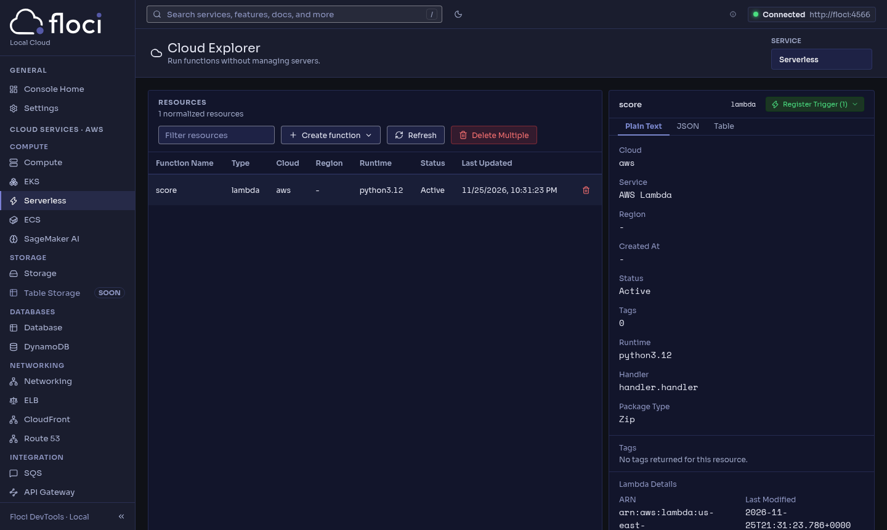
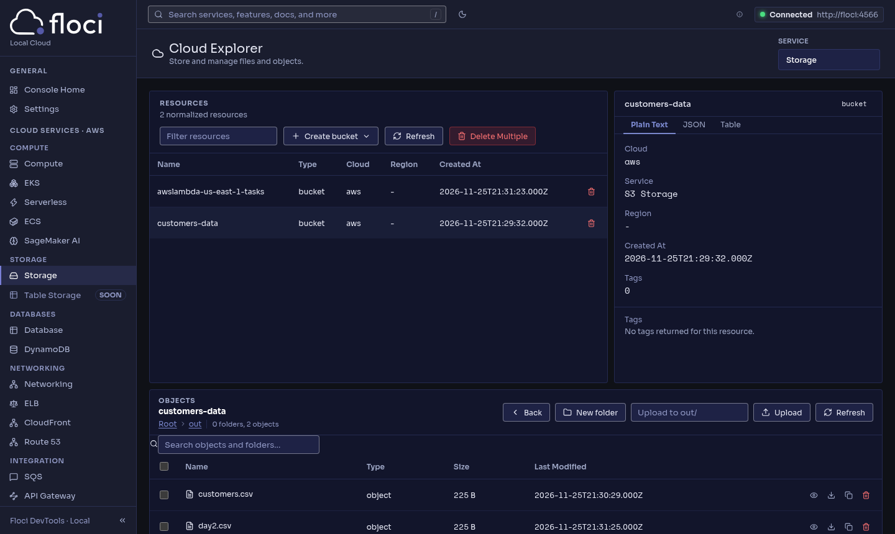
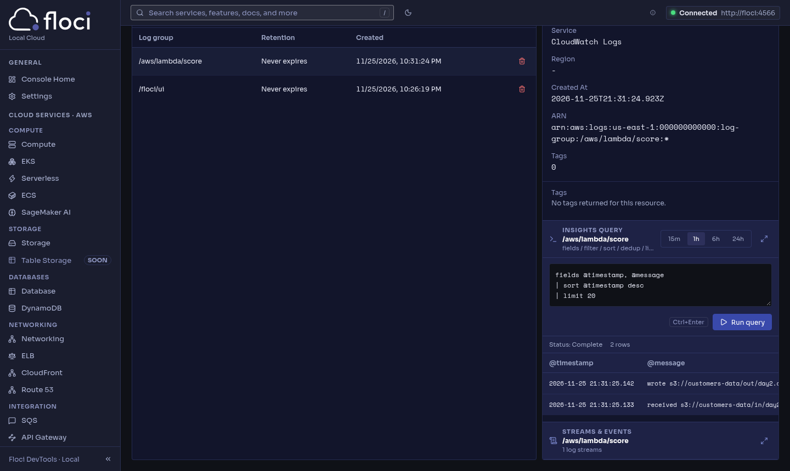

# 4 · No more machine: S3 triggers Lambda

**Goal**: a file dropped in `in/` triggers the scoring, with no machine at all.\
**Time**: 15 min

## Before you start

This branch adds `pipeline/`. You need what tutorial 3 left behind: the bucket `customers-data`.

On **your machine**, go to this tutorial's branch:

```bash
make step S=step-4-lambda
```

Only if you skipped the previous tutorials, or want to do this one again from scratch (fresh Floci, `lab/` and the previous tutorials' resources recreated):

```bash
make reset-step
```

Open the work terminal:

```bash
make shell
```

## 1. Read `pipeline/deploy.py`

Open `pipeline/deploy.py` in your editor. It does four things, all seen before:

| Function | What it does |
|---|---|
| `ensure_role()` | a role for Lambda (trust: `lambda.amazonaws.com`), allowed to read `in/`, write `out/` and write logs |
| `ensure_function()` | creates the function `score` from `pipeline/handler.py` + `scoring/score.py` |
| `ensure_permission()` | allows S3 to call the function |
| `ensure_notification()` | tells S3 to call the function for every file created under `in/` |

The policies are Python dictionaries: the same JSON as in tutorial 3.

## 2. Deploy

In the **work terminal**:

```bash
python pipeline/deploy.py
```

```
1. role          arn:aws:iam::000000000000:role/scoring-lambda-role
2. function      arn:aws:lambda:us-east-1:000000000000:function:score
3. permission    s3.amazonaws.com may invoke score for arn:aws:s3:::customers-data
4. notification  s3://customers-data/in/* -> score
```

In the console, **Serverless → score**. The badge **Register Trigger (1)** is the S3 notification.



## 3. Drop a file

In the **work terminal**:

```bash
aws s3 cp data/customers.csv s3://customers-data/in/day2.csv
```

A few seconds later (run it again if `day2.csv` is not there yet):

```bash
aws s3 ls s3://customers-data/out/
```

Print the result (`-` means "to the terminal"):

```bash
aws s3 cp s3://customers-data/out/day2.csv -
```

In the console, **Storage → customers-data → out**:



## 4. Read the logs

In the **work terminal**:

```bash
aws logs tail /aws/lambda/score
```

```
... received s3://customers-data/in/day2.csv
... wrote s3://customers-data/out/day2.csv: 8 rows, 4 predicted 1
```

In the console: **CloudWatch Logs → /aws/lambda/score → Run query**.



> **Takeaway**: the same `add_predictions()` as on the laptop. Only where it runs and what triggers it changed. When nothing happens, nothing is billed.
>
> *Floci*: the logs only hold what the handler prints. On AWS you also get `START`, `END` and `REPORT` lines (duration, memory, billed time).

---

*Intro to the cloud for ML engineers* — the same scoring script, moved to the cloud on a local AWS (Floci).

All tutorials: [`main`](https://github.com/ssime-git/intro-cloud-mlops) · This branch: `step-4-lambda` · Next: `make step S=step-5-final`
