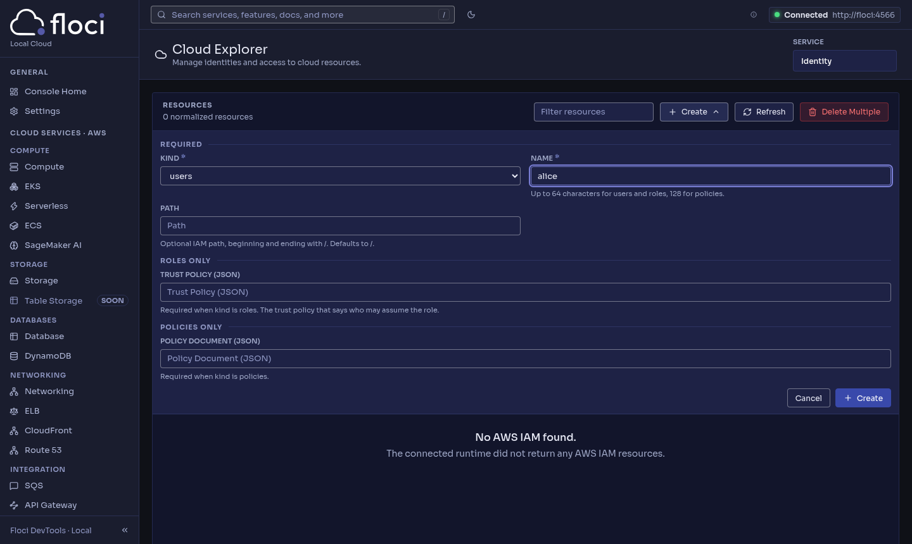
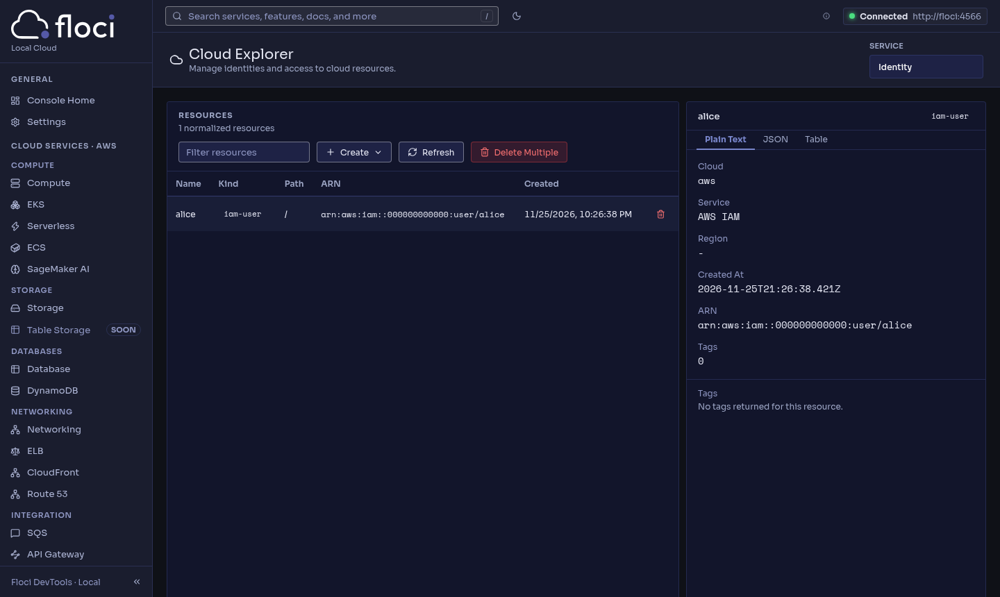

# 1 · A user, a denial, a policy

**Goal**: create a user, see that they have no rights, write them a policy.\
**Time**: 15 min

## Before you start

On **your machine**, go to this tutorial's branch:

```bash
make step S=step-1-identity
```

Only if you skipped the previous tutorials, or want to do this one again from scratch (fresh Floci, `lab/` and the previous tutorials' resources recreated):

```bash
make reset-step
```

Open the work terminal:

```bash
make shell
```

## 1. Create Alice in the console

In the console: **Security → Identity → Create** · Kind: `users` · Name: `alice` · **Create**.



Alice shows up with her ARN, her unique identifier in AWS:



## 2. Find her from the command line

Two different questions, two different commands.

**Who am I?** `sts` is the Security Token Service: the AWS service that answers "which identity signed this request?". `get-caller-identity` takes no argument; it returns the principal behind the keys the CLI used. Without any option, the CLI uses the work terminal's default keys, which belong to the account administrator (`root`):

```bash
aws sts get-caller-identity
```

```
"Arn": "arn:aws:iam::000000000000:root"
```

`root` is not a user someone created: it is the account itself, with full rights and no policy to attach.

**Does Alice exist?** `aws iam get-user` looks up an object by name. It does not say who is calling:

```bash
aws iam get-user --user-name alice
```

```
"Arn": "arn:aws:iam::000000000000:user/alice"
```

Same ARN as in the console. To see every identity of the account instead of one:

```bash
aws iam list-users --query 'Users[].UserName' --output text
```

```
alice
```

**Reading an ARN.** `arn:aws:iam::000000000000:user/alice` is `arn` (an AWS name), `aws` (the partition), `iam` (the service), an empty region (IAM is global), `000000000000` (the account), `user/alice` (the resource). `root` and `alice` share the account id and nothing else: two distinct identities in the same account.

> The console's identity page shows Alice's **record** (her ARN), not the caller. `get-caller-identity` shows the **caller**. That is why one screen says `alice` and the other `root`.

## 3. Give Alice access keys

In the **work terminal**:

```bash
aws iam create-access-key --user-name alice
```

```
"AccessKeyId": "AKIA...",
"SecretAccessKey": "..."
```

Now store these two values in a **profile** named `alice`. A profile is a named set of keys that the CLI keeps in the file `~/.aws/credentials` (here `/root/.aws/credentials`, inside the work terminal container). Replace `<AccessKeyId>` and `<SecretAccessKey>` with the values printed above:

```bash
aws configure set aws_access_key_id <AccessKeyId> --profile alice
```

```bash
aws configure set aws_secret_access_key <SecretAccessKey> --profile alice
```

Check what was saved:

```bash
cat ~/.aws/credentials
```

```
[alice]
aws_access_key_id = AKIA...
aws_secret_access_key = ...
```

From now on, adding `--profile alice` to a command makes the CLI sign it with Alice's keys instead of the administrator's:

```bash
aws sts get-caller-identity --profile alice
```

```
"Arn": "arn:aws:iam::000000000000:user/alice"
```

`--profile` is not an AWS API parameter: it is an option of the CLI itself, read before the request is sent. It tells the CLI which keys to load from `~/.aws/credentials`, then signs with them. The service (here `sts`) never sees it.

> The profile lives in the container: `make reset-step`, `make reset-all` or `make down` delete it.

## 4. See the denial

In the **work terminal**:

```bash
aws s3 ls --profile alice
```

```
An error occurred (AccessDenied) ... User is not authorized to perform: s3:ListAllMyBuckets
```

Alice's keys are valid, but she has no policy. The error gives the name of the missing action.

## 5. Write her policy

Need: "Alice can list the buckets". Action: `s3:ListAllMyBuckets` (read in the error). Resource: `*` (listing buckets targets no specific bucket).

Everything you create in the tutorials goes into the folder `lab/` of your repo. Git ignores it, so you cannot commit it by mistake.

In the **work terminal**:

```bash
mkdir -p lab
```

Write the policy to `lab/list-buckets.json` (copy the whole block, from `cat` to the last `JSON`):

```bash
cat > lab/list-buckets.json <<'JSON'
{
  "Version": "2012-10-17",
  "Statement": [{
    "Effect": "Allow",
    "Action": "s3:ListAllMyBuckets",
    "Resource": "*"
  }]
}
JSON
```

Attach it to Alice under the name `list-buckets`:

```bash
aws iam put-user-policy --user-name alice --policy-name list-buckets --policy-document file://lab/list-buckets.json
```

## 6. Try again

In the **work terminal**:

```bash
aws s3 ls --profile alice
```

No error (and no output: there is no bucket yet). The console does not show a user's policies; check them from the command line:

```bash
aws iam list-user-policies --user-name alice
```

```
"PolicyNames": ["list-buckets"]
```

## 7. Compare with a policy written by AWS

In the **work terminal**:

```bash
aws iam get-policy-version --policy-arn arn:aws:iam::aws:policy/AmazonS3ReadOnlyAccess --version-id v3
```

`s3:Get*` and `s3:List*` on `*`: read access to **every** bucket of the account. Handy to get started, too broad for production.

> **Takeaway**: no policy, no rights. A policy is actions (`service:Action`) on resources (ARNs). Start narrow, and only add what a real denial asks for.

---

*Intro to the cloud for ML engineers* — the same scoring script, moved to the cloud on a local AWS (Floci).

All tutorials: [`main`](https://github.com/ssime-git/intro-cloud-mlops) · This branch: `step-1-identity` · Next: `make step S=step-2-ec2`
