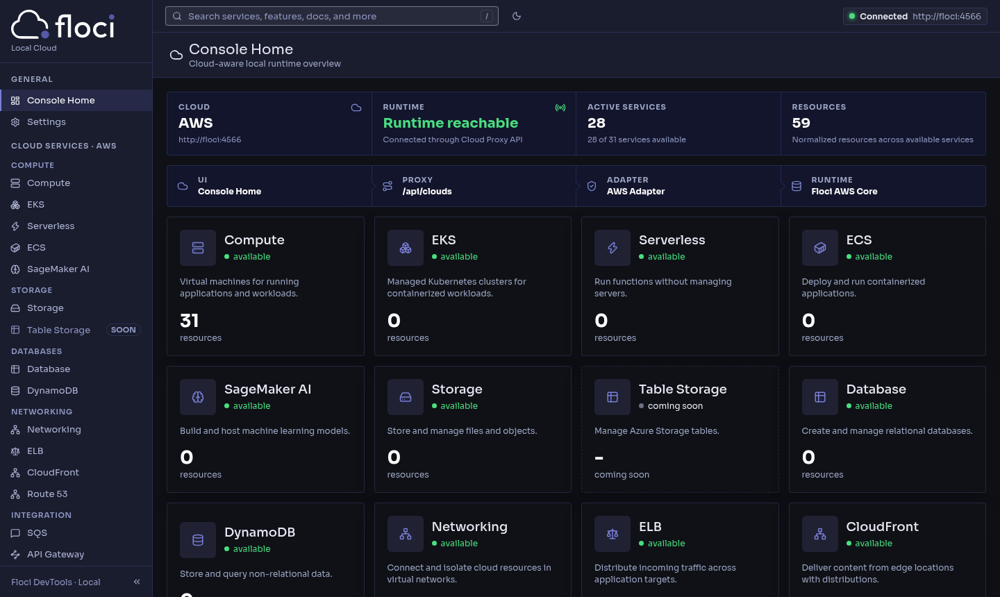

# 0 · Start your local AWS

**Goal**: start Floci (a local AWS), open its web console and the work terminal.\
**Time**: 5 min

## 1. Start Floci

On **your machine**, in the repo folder:

```bash
make step S=step-0-start
```

```bash
make up
```

`make up` starts two containers: `floci` (the emulated AWS) and `runner` (the work terminal). The first run downloads about 1.5 GB.

## 2. Open the console

On **your machine**:

```bash
make console
```

If no browser opens, go to http://localhost:4566/_floci/ui. The first opening takes a few seconds ("Starting Floci UI…"), then you land on http://localhost:4500.



Keep this tab open: every resource you create in the tutorials shows up here.

## 3. Open the work terminal

On **your machine**:

```bash
make shell
```

The prompt changes to `root@…:/work#`. You are in the container, in `/work`, which is your repo folder.

In the **work terminal**:

```bash
aws --version
```

```
aws-cli/2.x.x Python/3.x.x Linux/...
```

To leave the work terminal (back to your machine), type `exit`.

> **Takeaway**: this is the real AWS CLI. The variable `AWS_ENDPOINT_URL=http://floci:4566`, set in the work terminal, sends every command to Floci: the commands are exactly those of real AWS.
>
> **Start over**: `make reset-step` on your machine.
