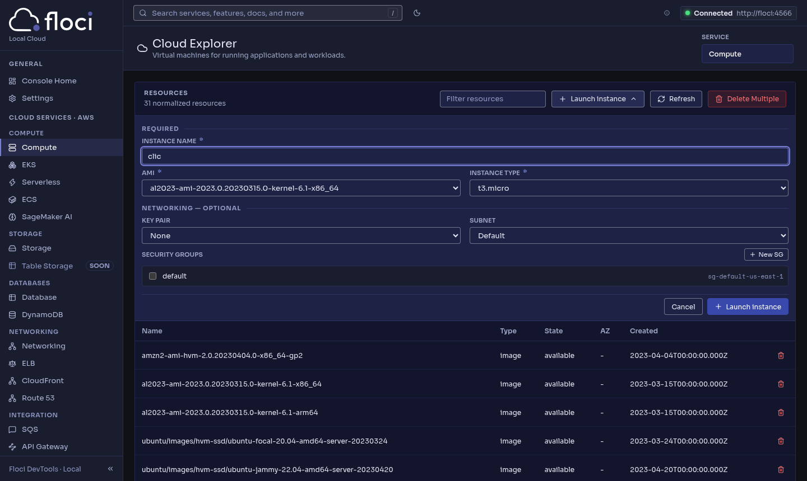
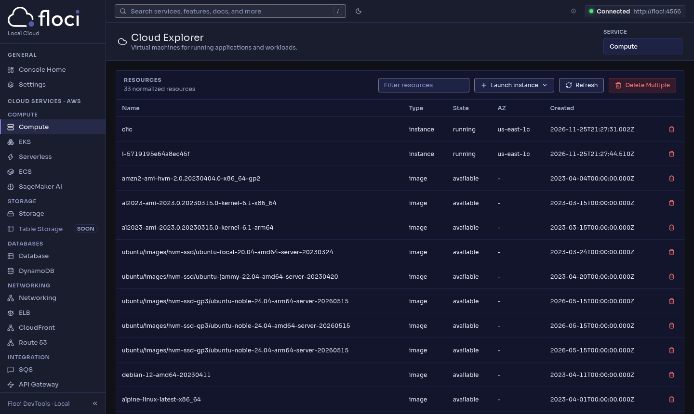
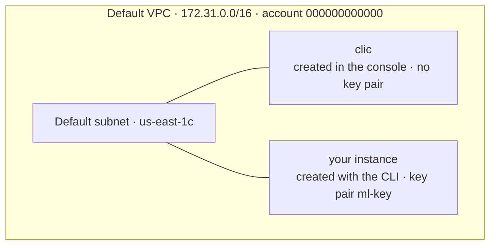
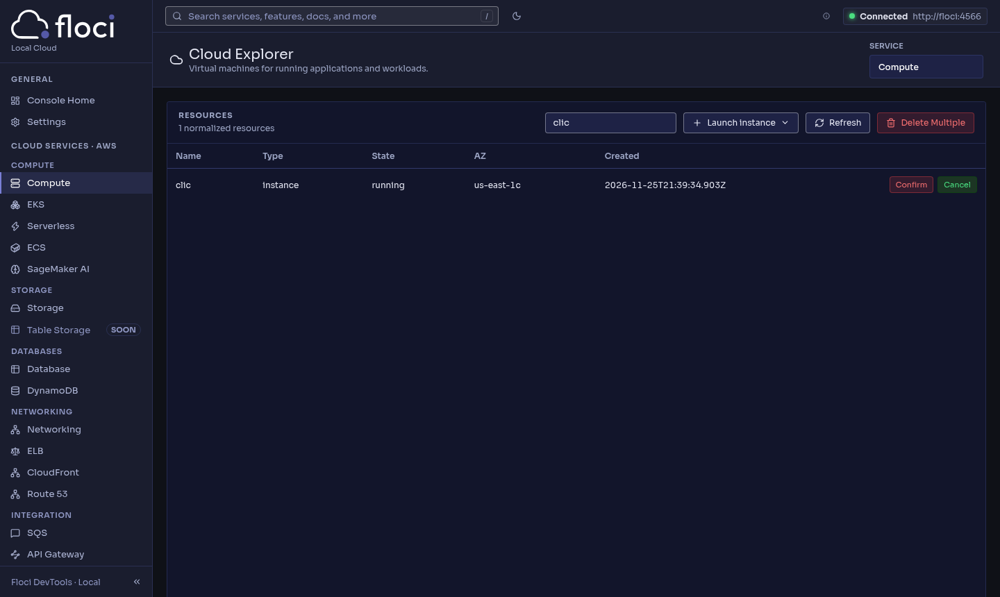

# 2 · Rent a machine (EC2)

**Goal**: launch an instance, SSH into it, run `score.py` there, destroy it.\
**Time**: 15 min

## Before you start

This branch adds `scoring/score.py` and `data/customers.csv`.

On **your machine**, go to this tutorial's branch:

```bash
make step S=step-2-ec2
```

Only if you skipped the previous tutorials, or want to do this one again from scratch (fresh Floci, `lab/` and the previous tutorials' resources recreated):

```bash
make reset-step
```

Open the work terminal:

```bash
make shell
```

## 1. The script runs on "my laptop"

In the **work terminal** (it plays the laptop here):

```bash
python scoring/score.py data/customers.csv /tmp/out.csv
```

```bash
cat /tmp/out.csv
```

A `prediction` column was added: 1 if `score > 0.5`, else 0.

## 2. Launch an instance with the mouse

In the console: **Compute → Launch instance** · Instance name: `clic` · AMI: `al2023-ami-2023.0.20230315.0-kernel-6.1-x86_64` · Instance type: `t3.micro` · Key pair: `None` · **Launch instance**.



### What the fields mean

**AMI** (Amazon Machine Image): the disk image the machine boots from, OS and preinstalled tools included. `al2023-ami-2023.0.20230315.0-kernel-6.1-x86_64` is Amazon Linux 2023, the default for AWS tutorials; its ID is `ami-0abcdef1234567891`. The AMI fixes the OS, not the hardware.

**Instance type**: the hardware, billed per second for as long as the instance exists. `t3.micro` is 2 vCPU and 1 GiB of RAM: `t` is the burstable family (cheap, it shares the physical CPU), `3` the generation, `micro` the size.

**Subnet**: the network segment the machine's network card is plugged into. A VPC is a private network (`172.31.0.0/16` by default); a subnet is a smaller range (`172.31.0.0/20`) inside it, in one availability zone, that is one datacenter. The subnet decides both the private IP range and where the machine physically runs. `Default` picks one of the three subnets that come with the default VPC.

**Key pair** (`None` here): the SSH key injected at boot. Without one, no SSH — the next step creates it.

### Floci vs a real AWS account

Same fields, different machinery behind them:

| Field | Real AWS | Floci |
|---|---|---|
| AMI | Boot disk snapshot; thousands per region, each tied to an architecture | Short catalog (`aws ec2 describe-images`), each entry mapped to a Docker image: `ami-amazonlinux2023` → `public.ecr.aws/amazonlinux/amazonlinux:2023` |
| Instance type | Real hardware, real capacity | A catalog entry turned into Docker limits: `t3.micro` = 2 vCPU (`NanoCpus`) and 1 GiB (`Memory`) |
| Subnet | Real network segment in one datacenter; its CIDR gives the private IP | Pre-created default VPC `172.31.0.0/16` and three default subnets in `us-east-1a/b/c`; the subnet ID and AZ are stored and returned, but the IP is the container's Docker address (e.g. `172.29.0.5`), outside the subnet CIDR |
| Availability zone | A distinct datacenter: latency and failure domain | A label; no latency or failure difference between zones |
| VPC, internet gateway, route table | Real routing | Created by default so tools and Terraform work; no routing emulated |
| Key pair | Public key stored by AWS, injected at boot | Same: public key written to `/root/.ssh/authorized_keys`; port 22 published on a host port in `2200–2299` |
| Security group | Stateful firewall filtering traffic | Stored, and used to decide which ports are published on the host; does not filter traffic unless `FLOCI_NETWORK_SECURITY_GROUP_ENFORCEMENT_ENABLED=true` |
| Instance lifecycle | Hypervisor VM: start, stop, reboot, terminate | Docker container: same states map to `docker start/stop/restart/rm` |
| Billing | Per second, per instance type | Nothing |

## 3. Launch an instance from the command line

In the **work terminal**, create an SSH key pair. AWS keeps the public key; the private key is saved to `lab/ml-key.pem` in your repo (git-ignored):

```bash
mkdir -p lab
```

```bash
aws ec2 create-key-pair --key-name ml-key --query KeyMaterial --output text > lab/ml-key.pem
```

`ssh` refuses a private key that others can read:

```bash
chmod 400 lab/ml-key.pem
```

Launch the instance and keep its ID in the shell variable `ID`. This creates a **second** instance: `clic` and this one are independent machines, not two views of the same one.

```bash
ID=$(aws ec2 run-instances --image-id ami-amazonlinux2023 --instance-type t3.micro --key-name ml-key --query 'Instances[0].InstanceId' --output text)
```

`--image-id` takes the AMI (here its alias, `ami-amazonlinux2023`), `--instance-type` the hardware. No `--subnet-id`: Floci picks a default subnet, and the instance lands in that subnet's zone.

```bash
echo $ID
```

Wait until it runs (about 10 s):

```bash
aws ec2 wait instance-running --instance-ids $ID
```

```bash
aws ec2 describe-instances --query 'Reservations[].Instances[].[InstanceId,State.Name]' --output table
```

Two instances: `clic` and yours. Nothing links them beyond the account, the region and the default subnet: `clic` has no key pair and no name tag, yours has `ml-key`. In the console, click **Refresh**: they are at the top of the list, above the images (AMIs).





Both machines sit in the same subnet and show up in the same list, but they are separate: different instance IDs, different lifecycles, different keys.

> **Could we attach `ml-key` to `clic` instead?** No. The key pair is fixed at launch, and `aws ec2 modify-instance-attribute` has no `--key-name` (the CLI answers `Unknown options`). The instance has to be recreated — here, terminate it and launch a new one with `--key-name ml-key`. In general, save it as an image first:
>
> ```bash
> CLIC=$(aws ec2 describe-instances --filters Name=tag:Name,Values=clic --query 'Reservations[0].Instances[0].InstanceId' --output text)
> AMI=$(aws ec2 create-image --instance-id $CLIC --name clic-with-key --no-reboot --query ImageId --output text)
> aws ec2 wait image-available --image-ids $AMI
> aws ec2 run-instances --image-id $AMI --instance-type t3.micro --key-name ml-key
> ```
>
> On Floci only, the instance is a container, so on **your machine** (with `CLIC` set there, or its ID typed in full) you can write the public key straight into it:
>
> ```bash
> ssh-keygen -y -f lab/ml-key.pem | docker exec -i floci-aws-ec2-$CLIC sh -c 'cat >> /root/.ssh/authorized_keys'
> ```

Terminate `clic` in the console: bin icon on its row, then **Confirm**.



> `ID` only lives in this terminal. If you closed it, get it back with:
> `ID=$(aws ec2 describe-instances --filters Name=instance-state-name,Values=running Name=key-name,Values=ml-key --query 'Reservations[0].Instances[0].InstanceId' --output text)`

## 4. Get into the machine

In the **work terminal**, get the instance's IP address:

```bash
IP=$(aws ec2 describe-instances --instance-ids $ID --query 'Reservations[0].Instances[0].PrivateIpAddress' --output text)
```

Copy the script and the data to the instance (`root@$IP:` means the home folder of `root` on the instance). The SSH server needs about 30 s after launch: if you get `Connection refused`, wait and try again.

```bash
scp -i lab/ml-key.pem scoring/score.py data/customers.csv root@$IP:
```

Open a session on the instance:

```bash
ssh -i lab/ml-key.pem root@$IP
```

The prompt changes to `[root@… ~]#`: you are **on the EC2 instance**. Run the same script there:

```bash
python3 score.py customers.csv out.csv && cat out.csv
```

<details>
<summary><strong>Why does it work without installing anything?</strong></summary>

`score.py` only imports `csv`, `io` and `sys`: three modules of Python's **standard library**, shipped with the interpreter. Nothing to download, so nothing to install.

An installation is only needed for a third-party package (`pandas`, `numpy`, `boto3`…). That is what `pip install` is for, and it is exactly what step 3 brings with boto3.

And `python3` is already there because the **AMI** provides it: Amazon Linux 2023 ships Python 3.9, `ssh`, `scp`… That is the AMI's job seen in step 2 — OS and preinstalled tools — not your code's.

</details>

Back to the work terminal:

```bash
exit
```

## 5. Destroy the machine

In the **work terminal**:

```bash
aws ec2 terminate-instances --instance-ids $ID
```

> **Takeaway**: `out.csv` disappeared with the machine, and the machine was billed every second, even unused. Two problems the next tutorials solve.
>
> *Floci*: the instance is a Docker container; the work terminal reaches it on its private IP. On AWS you would go through a public IP or a bastion.
