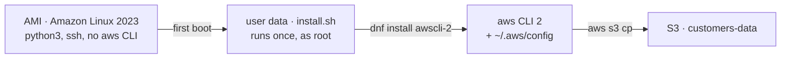
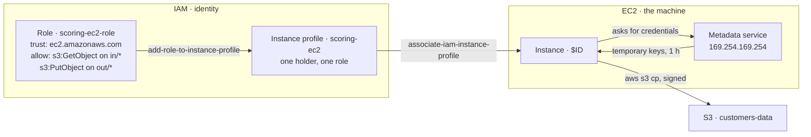
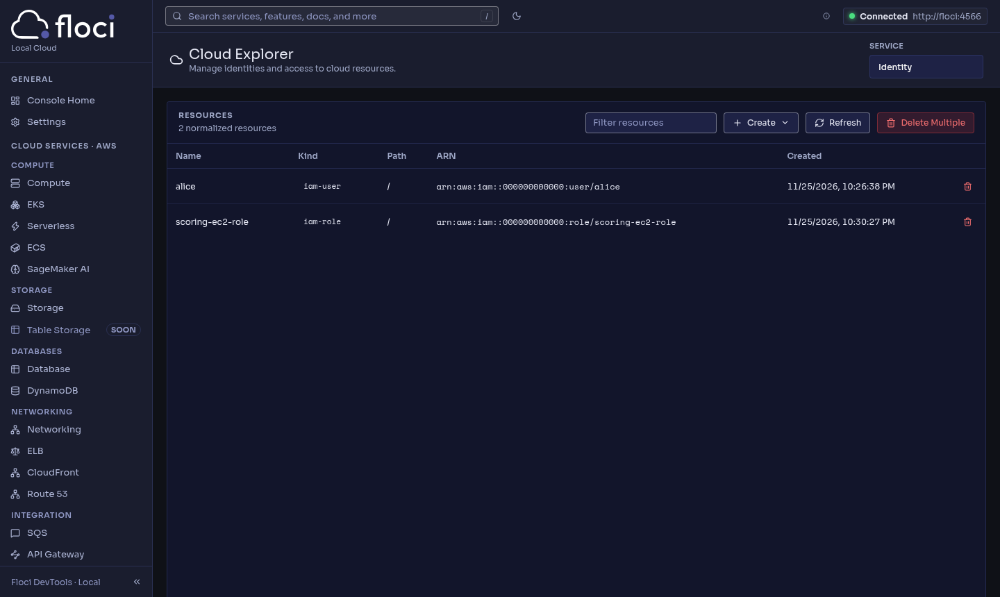
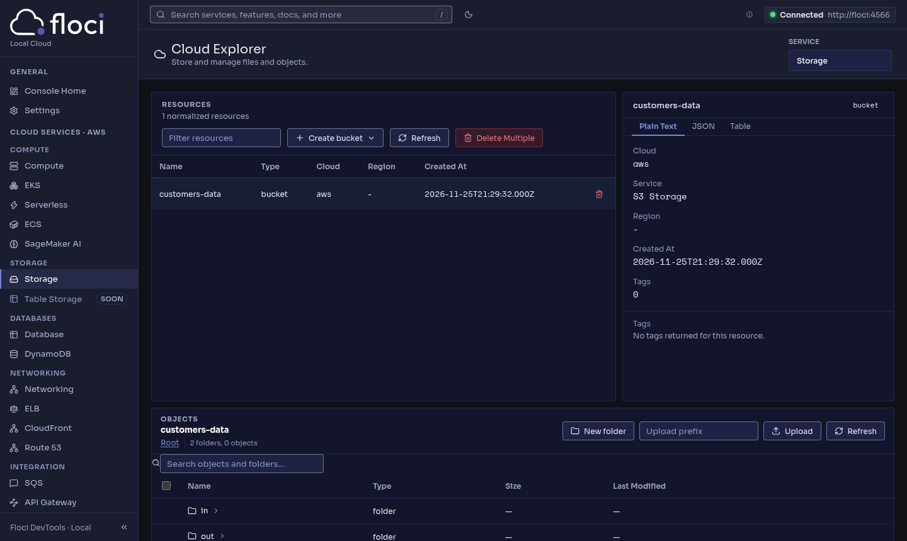

# 3 · Data leaves the machine, the machine gets a role

**Goal**: store the data in S3, and give the machine rights without copying any key.\
**Time**: 20 min

## Before you start

This branch adds `scoring/install.sh`. You need what tutorial 2 left behind: the key `lab/ml-key.pem`.

On **your machine**, go to this tutorial's branch:

```bash
make step S=step-3-s3-role
```

Only if you skipped the previous tutorials, or want to do this one again from scratch (fresh Floci, `lab/` and the previous tutorials' resources recreated):

```bash
make reset-step
```

Open the work terminal:

```bash
make shell
```

## 1. A bucket and the data

In the **work terminal**, create the bucket `customers-data`:

```bash
aws s3 mb s3://customers-data
```

Upload the data under the prefix `in/`:

```bash
aws s3 cp data/customers.csv s3://customers-data/in/customers.csv
```

> **Where the object goes.** This stack runs Floci in `memory` mode: no `FLOCI_STORAGE_MODE` is set in `docker-compose.yml`, so the default applies. The bucket and its objects live in the Floci process's RAM, keyed by account / bucket / key. Nothing is written to disk, so there is no file to `ls` in the container, `docker restart floci` or `make down` loses everything — `make reset-step` is not the only command that wipes — and the size is bounded by the container's memory, not by an S3 quota. Real S3 writes each object to disks and replicates it across at least three availability zones. To keep objects across restarts, set `FLOCI_STORAGE_MODE=persistent` (or `hybrid`) and mount a volume on `/app/data`: each body becomes a `<key>.s3data` file under the bucket's directory.

## 2. A machine with the AWS CLI

`scoring/install.sh` is a script the instance runs once at boot (*user data*). It installs the AWS CLI.



Why it is needed: the AMI brings the OS and its tools (`python3`, `ssh`), not the AWS CLI. Without `install.sh`, the `aws s3 cp` below answers `aws: command not found`. User data is how a machine is prepared at launch, without logging into it: the file is passed to `run-instances`, copied in, and executed at first boot.

In the **work terminal**:

```bash
ID=$(aws ec2 run-instances --image-id ami-amazonlinux2023 --instance-type t3.micro --key-name ml-key --user-data file://scoring/install.sh --query 'Instances[0].InstanceId' --output text)
```

```bash
aws ec2 wait instance-running --instance-ids $ID
```

```bash
IP=$(aws ec2 describe-instances --instance-ids $ID --query 'Reservations[0].Instances[0].PrivateIpAddress' --output text)
```

Wait about 40 s (SSH server, then the CLI install), then copy the script:

```bash
scp -i lab/ml-key.pem scoring/score.py root@$IP:
```

```bash
ssh -i lab/ml-key.pem root@$IP
```

**On the EC2 instance**, try to read the data:

```bash
aws s3 cp s3://customers-data/in/customers.csv .
```

```
fatal error: Unable to locate credentials
```

The machine has no rights at all. (If you get `aws: command not found`, `install.sh` is still running: wait 10 s.)

```bash
exit
```

## 3. Write the role

A role needs two policies: **who** may wear it (trust policy), and **what** it allows.

In the **work terminal**, who: the EC2 service. Write `lab/trust-ec2.json`:

```bash
cat > lab/trust-ec2.json <<'JSON'
{
  "Version": "2012-10-17",
  "Statement": [{
    "Effect": "Allow",
    "Principal": { "Service": "ec2.amazonaws.com" },
    "Action": "sts:AssumeRole"
  }]
}
JSON
```

What: read `in/`, write `out/`. Write `lab/scoring-s3.json`:

```bash
cat > lab/scoring-s3.json <<'JSON'
{
  "Version": "2012-10-17",
  "Statement": [
    { "Effect": "Allow", "Action": "s3:GetObject", "Resource": "arn:aws:s3:::customers-data/in/*" },
    { "Effect": "Allow", "Action": "s3:PutObject", "Resource": "arn:aws:s3:::customers-data/out/*" }
  ]
}
JSON
```

Create the role `scoring-ec2-role` with the trust policy:

```bash
aws iam create-role --role-name scoring-ec2-role --assume-role-policy-document file://lab/trust-ec2.json
```

Attach what it allows:

```bash
aws iam put-role-policy --role-name scoring-ec2-role --policy-name scoring-s3 --policy-document file://lab/scoring-s3.json
```

## 4. Attach the role to the machine

A role is an IAM object. EC2 does not attach roles directly: it attaches an **instance profile**, a holder that contains exactly one role. Three objects, three commands, in this order:

1. `create-instance-profile` creates the empty holder `scoring-ec2`.
2. `add-role-to-instance-profile` puts `scoring-ec2-role` inside it.
3. `associate-iam-instance-profile` bolts the holder onto the instance `$ID`.



| Object | What it is | Created by |
|---|---|---|
| Role | Permissions, plus who may wear it (the trust policy) | Section 3 |
| Instance profile | Holder for one role, and the only thing EC2 accepts | `create-instance-profile` + `add-role-to-instance-profile` |
| Association | The link profile → instance, destroyed with the instance | `associate-iam-instance-profile` |

Nothing is copied onto the machine: once the association exists, the instance asks its metadata service for credentials and receives temporary keys for the role (next section).

In the **work terminal**:

```bash
aws iam create-instance-profile --instance-profile-name scoring-ec2
```

```bash
aws iam add-role-to-instance-profile --instance-profile-name scoring-ec2 --role-name scoring-ec2-role
```

```bash
aws ec2 associate-iam-instance-profile --instance-id $ID --iam-instance-profile Name=scoring-ec2
```

In the console, **Identity**: the role is there next to Alice.



## 5. Work with temporary keys

In the **work terminal**:

```bash
ssh -i lab/ml-key.pem root@$IP
```

**On the EC2 instance**, the machine fetches temporary keys (with an expiry date) from the metadata service. Nobody copied them:

```bash
curl -s http://169.254.169.254/latest/meta-data/iam/security-credentials/scoring-ec2-role
```

Read the data, score it, write the result:

```bash
aws s3 cp s3://customers-data/in/customers.csv .
```

```bash
python3 score.py customers.csv out.csv
```

```bash
aws s3 cp out.csv s3://customers-data/out/customers.csv
```

Now an action the role does not allow:

```bash
aws s3 ls s3://customers-data/in/
```

```
An error occurred (AccessDenied) ... User is not authorized to perform: s3:ListBucket
```

Scoring does not need it: we do not add it. That is least privilege.

```bash
exit
```

## 6. The result outlives the machine

In the **work terminal**:

```bash
aws ec2 terminate-instances --instance-ids $ID
```

```bash
aws s3 ls s3://customers-data/out/
```

In the console, **Storage → customers-data**: the folders `in/` and `out/`.



> **Takeaway**: the data lives in S3, not on the machine. A service wears a role, never a key. One problem left: we pay for a whole machine for 2 seconds of computing.
>
> *Floci*: `install.sh` also writes `/root/.aws/config` on the instance so its CLI talks to Floci. Remove that part on a real EC2 instance.
