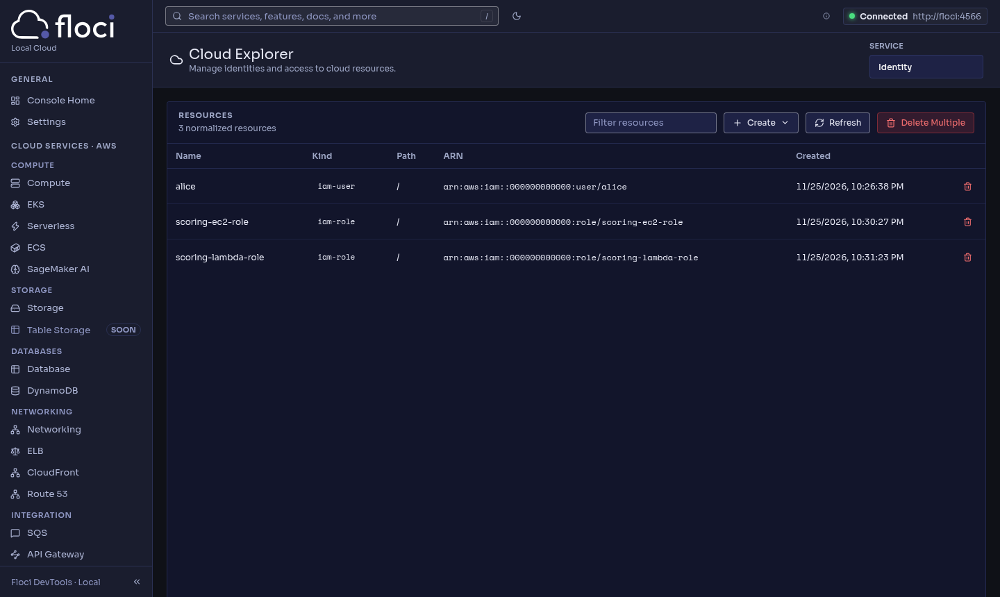

# 5 · The final architecture, and starting over

**Goal**: review what we built, see it described in Terraform, then reset everything.\
**Time**: 5 min

## Before you start

This branch adds `infra/main.tf`.

On **your machine**, go to this tutorial's branch:

```bash
make step S=step-5-final
```

Only if you skipped the previous tutorials, or want to do this one again from scratch (fresh Floci, `lab/` and the previous tutorials' resources recreated):

```bash
make reset-step
```

## 1. The 5 questions, on the final architecture

| Question | Answer | In the console |
|---|---|---|
| What triggers the work? | a file in `in/` | **Storage → customers-data** |
| Where does the data live? | S3 | **Storage → customers-data** |
| Who may do what? | one role per service | **Identity** |
| What do we pay when nothing happens? | nothing | **Compute**: no running instance |
| How do we know it works? | the logs | **CloudWatch Logs** |



## 2. The same infrastructure in Terraform

Open `infra/main.tf` in your editor (to read, not to run): the bucket and the role of tutorial 3, reusing the policy files you wrote in `lab/`. We describe the **desired state**, and Terraform works out the steps.

## 3. Reset everything

If you are in the work terminal, leave it:

```bash
exit
```

On **your machine**, stop and remove all containers, go back to `step-0-start` and delete what you created (the folder `lab/`):

```bash
make reset-all
```

To do everything again from the start, follow [tutorial 0](00-getting-started.md):

```bash
make up
```
